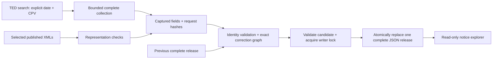

# NoticeBridge


**A public notice changes. The original should remain inspectable, and the comparison should explain its evidence.**

[Explore the result](https://vasilendata.github.io/noticebridge-data-platform/?notice=789562-2026#explorer) · [Inspect the engineering](noticebridge/engine.py) · [Source contract](docs/SOURCES.md) · [Delivery brief](docs/DELIVERY_PROMPT.md)

NoticeBridge turns a bounded capture of real TED procurement notices into a searchable
change explorer. I implemented explicit correction-link resolution, immutable
publication identities, selected-field comparisons and a staged JSON publication
boundary. The browser shows the source, comparison and unknowns together.

## A real change to inspect

[Publication 789562-2026](https://ted.europa.eu/en/notice/-/detail/789562-2026)
explicitly corrects
[publication 706866-2026](https://ted.europa.eu/en/notice/-/detail/706866-2026).
The captured earliest reported lot deadline moves from **18 November to 25 November
2026**. The explorer shows those dates beside the original links. This describes
selected captured fields, not a legal interpretation of all tender documents.

The first capture contains **229 notices matching the 13 November 2026 IT query**,
plus **72 earlier notices** fetched as bounded correction context. Five older
correction references remain unresolved and visible. All pages of the primary query,
including its terminal empty page, reconcile to the API's reported population.
The collector also compared six selected identifier/date checks in each of five
published XML representations with the API data. These 30 checks concern two
representations from the same publisher, not independent-source corroboration.

**Scope:** real public data, captured on 15 November 2026. A read-only portfolio
demonstrator with labelled synthetic adversarial tests. It has no customers, paid
backend, measured commercial savings or established multiweek operating history.
It does not claim to list every open IT opportunity.

## The difficult boundary

TED has both procurement-stage predecessors and explicit correction references.
Using the former as an edit relationship can manufacture a misleading comparison.
NoticeBridge uses only the correction relationship, preserves unresolved references,
and refuses ambiguous identity or cyclic history.

Finding an older parent later is also different from changing the child's published
content. Original correction pointers remain part of the stable source identity;
the resolved edge is derived against the retained publication history. A later
capture can therefore resolve an orphan without silently rewriting the publication.

## What the system demonstrates

| Concern | Inspectable behavior |
|---|---|
| Partial collection | A timed-out page, changed population or missing pagination token prevents replacing the source snapshot. |
| Meaning of a correction | Exact published references only; missing and ambiguous parents stay visible. |
| Immutable identity | Repeated content is idempotent; conflicting content under the same publication ID is refused. |
| Historical context | Previously captured publications are retained; absence from a later selection is not called a withdrawal. |
| More than one deadline | The full reported date set is retained and compared; the earliest date is explicitly labelled and is not assumed to govern every lot. |
| Failed publication | A synchronized process-interruption exercise checks that the previous complete consumer file survives and a retry can publish. |
| Concurrent publishers | An OS-owned advisory lock rejects a competing publisher and is released when its process exits. |
| Reproducibility | Source, normalized code and payload fingerprints identify the complete release. |
| Browser safety | Text-safe rendering, exact TED-link validation and formula-safe CSV export. |

## Architecture



Python 3.11+, standard library, pytest, vanilla JavaScript, Node's test runner and
GitHub Actions. A database or message broker is unnecessary for this bounded
snapshot-and-comparison workload. The runtime has no third-party Python dependency.

## Reproduce the published snapshot

```sh
python -m venv .venv
# Activate .venv using your shell, then:
python -m pip install -r requirements-dev.txt
python -m noticebridge verify --source data/source_snapshot.json --output web/data.json
pytest -q
node --test web/test-ui.mjs
python -m noticebridge exercise --output local-evidence/recovery.json
python package_site.py
python -m http.server 8770 --directory site
```

Open `http://localhost:8770`. The exercise requires a new output-report path and
uses its own temporary synthetic fixtures. It does not modify the published source
snapshot. The site packager includes only the validated, allowlisted public files.

To build a fresh consumer file from the frozen source:

```sh
python -m noticebridge build --source data/source_snapshot.json --output local-evidence/data.json
```

To collect a new bounded official publication query, see [the source commands and
limits](docs/SOURCES.md). A new collection can change source facts; the offline
verification workflow does not silently refresh this dated evidence.

## Evidence and limits

The [dated local recovery exercise](docs/recovery-exercise-2026-11-15-final.json)
passed 16 checks, including a competing writer, observed interruption before atomic
replacement, preserved consumer bytes, lock release and successful retry. The
Python regression suite passed 59 tests and the browser utility suite passed six.
These are local observations; hosted CI retains its own execution evidence.

The [source snapshot](data/source_snapshot.json) includes the selected original fields,
request/response fingerprints, capture times, coverage, unresolved references and
the XML comparison results. No contact-field harvesting is performed. The public
browser consumes the compact derived release.

CI reruns the source/compiler/browser regressions, verifies the checked-in release,
and records a new synthetic interruption/recovery exercise before publishing the
static site. Its downloadable evidence artifacts are retained for 14 days.

Buyer country is not place of performance. Rule matching is illustrative and has
no independently labelled relevance benchmark. Missing fields remain unknown.
Selected-field equality does not establish that entire documents are unchanged.
Use the official notice for current status and requirements.

Implementation and review are AI-assisted. This project does not establish the
owner's unaided interview performance, independent human review or production
adoption. [Engineering decisions and promotion criteria](docs/DECISIONS.md).

Source: TED / Supplement to the Official Journal of the European Union,
© European Union. [Reuse notice](https://ted.europa.eu/en/legal-notice).
The project applies normalization and comparison; it is not affiliated with TED.
