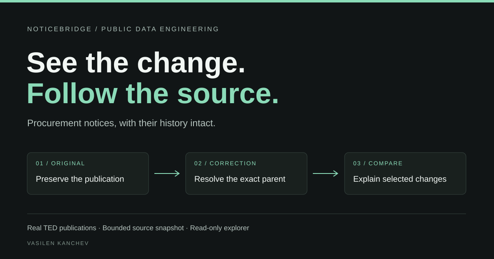

# NoticeBridge



**Real procurement notices change. Reconstruct what was observed, explain the correction, and preserve the last valid result when an update fails.**

[Explore the result](https://vasilendata.github.io/noticebridge-data-platform/) · [Inspect operating evidence](https://vasilendata.github.io/noticebridge-data-platform/#operations) · [Inspect the engineering](noticebridge/operations.py) · [Runbook](docs/OPERATIONS.md)

I built NoticeBridge to turn messy, explicitly linked TED publications into an
inspectable change history. The Python pipeline archives original captures,
reconstructs every edition from empty state, and publishes the data and run ledger
through one verified pointer. The read-only explorer supports historical editions,
source-linked deadline comparisons, search, filters and CSV export.

## What makes this more than a dashboard

- **Real source semantics:** correction references are separate from procurement-stage predecessors. Similar titles never create an invented revision link.
- **Independent historical replay:** retained notices must be reconstructed from original captures, rather than trusting the current output as its own history.
- **Safe incremental repair:** a conflicting recapture or cross-capture cycle is rejected before the archive index changes. Earlier publication partitions can be backfilled using their actual later observation times.
- **One coherent consumer edition:** immutable, hashed assets are staged and verified before a single pointer selects both data and operations metadata. The browser also verifies the downloaded bytes.
- **Observed failure evidence:** a controlled child-process kill preserves the prior pointer and both consumer assets; recovery and exact-source repair are exercised. These are explicitly synthetic local scenarios.
- **Useful output:** inspect changes, navigate the original sources, compare a historical edition and export the exact filtered population. Missing history and fields remain visible.

## Dated real-data evidence

The initial expanded edition was built on **15 November 2026** from six captures:
the original snapshot plus a five-publication-day backfill for November 9–13.

| Observed evidence | Scope |
|---|---|
| **1,457 unique notices** | 1,150 unique primary notices plus correction context; bounded IT query, not all opportunities |
| **6 immutable captures / 5 publication dates** | All observed on one actual day; historical backfill is not five days of operation |
| **17 HTTP 429 responses recovered** | Recorded source attempts with bounded retries; 15 occurred during the new five-day backfill |
| **180 passing API/XML checks** | Selected identifier/date comparisons, including repeated observations; both representations have the same publisher |
| **Zero selected-field identity conflicts** | Across overlapping notice IDs in the dated captures |
| **Full replay equals the incremental result** | Every generated historical edition verifies against the archived source sequence |

Counts describe the initial expanded edition, not a perpetual promise about the
latest capture. The [public capture and replay ledger](https://vasilendata.github.io/noticebridge-data-platform/#operations)
shows the current evidence, acquisition attempts, clocks and archive capacity.

### A concrete change

[789562-2026](https://ted.europa.eu/en/notice/-/detail/789562-2026) explicitly corrects
[706866-2026](https://ted.europa.eu/en/notice/-/detail/706866-2026). The captured
**earliest reported lot deadline moves from 18 to 25 November 2026**. The full
reported date set is retained without inventing an association between dates and
individual lots. This is a selected-field comparison, not a legal interpretation
or a claim that the opportunity is currently open.

## Architecture

```mermaid
flowchart LR
    TED[TED iteration API + selected XML] --> COLLECT[Bounded complete partition capture]
    COLLECT --> CANDIDATE[Replay entire candidate batch against history]
    CANDIDATE --> ARCHIVE[Immutable captures + ordered index]
    ARCHIVE --> REPLAY[Reconstruct all editions from empty state]
    REPLAY --> ASSETS[Hashed data editions + operations ledger]
    ASSETS --> VERIFY[Independent archive replay and byte comparison]
    VERIFY --> POINTER[Atomically replace current.json]
    POINTER --> WEB[Hash-verifying read-only explorer]
```



Python 3.11+, standard library, pytest, vanilla JavaScript, Node's test runner and
GitHub Actions. No database, paid cloud account, LLM or message broker is needed
for this bounded capture/replay workload. The production Python runtime has no
third-party dependencies.

## Reproduce and inspect

```sh
python -m venv .venv
# Activate .venv using your shell, then:
python -m pip install -r requirements-dev.txt
pytest -q
node --test web/test-ui.mjs
python -m noticebridge.operations verify
python -m noticebridge.edition_exercise --output local-evidence/new-recovery.json
python package_site.py
python -m http.server 8770 --directory site
```

The exercise requires a fresh output path and uses isolated synthetic fixtures.
See the [dated edition recovery record](docs/edition-recovery-2026-11-15-final.json),
[source contract](docs/SOURCES.md), [review findings](docs/REVIEW.md), and
[operating runbook](docs/OPERATIONS.md). `data/source_snapshot.json` and `web/data.json`
retain the original 301-notice example for compatibility; the current interface
loads `current.json` and the verified versioned editions.

## Refresh and honest boundaries

The bounded refresh command collects a three-calendar-day lookback and accepts
only a fully replayable batch. A manual GitHub workflow also prepares the commit
and verification dispatch. **Hosted collection is currently blocked:** on November
15 TED returned an explicit XML access challenge to GitHub's runner. The collector
refused it, the prior published edition stayed available, and the schedule was
disabled rather than repeatedly requesting challenged access. Local real-source
collection succeeded; no successful hosted refresh is claimed. See the
[dated incident and recovery boundary](docs/OPERATIONS.md#observed-hosted-incident-15-november-2026).

Tests, recovery exercises, independent replay and package checks precede Pages
deployment. Browser freshness is visible; no notification delivery or SLA is claimed.

The archive stops at **100 captures or 50,000 retained notices** instead of silently
throwing away historical evidence. Capacity, failure response and the migration
boundary are documented in the runbook. All immutable public assets are retained
so previously fetched pointers can still resolve after deployment.

**Scope:** real public data and a read-only portfolio product. The initial backfill
was collected in one session. This does not establish multiweek operation, paying
customers, procurement outcomes or commercial savings. Buyer country is not place
of performance. Matching rules do not determine eligibility or predict awards.

Implementation and review are AI-assisted; they do not establish independent human
review or the owner's unaided interview performance. The project is suitable for a
flagship walkthrough centred on capture, replay, failure and recovery. Choosing it
for a three-project CV should follow the target role, not just its newer design.

Source: TED / Supplement to the Official Journal of the European Union,
© European Union. [Reuse notice](https://ted.europa.eu/en/legal-notice).
MIT covers this project's code, not a relicensing of the source publications.
This project is not affiliated with TED. [Delivery prompt](docs/DELIVERY_PROMPT.md).
